# Ember & Tide

**A calm, local-first controller for a dual-zone water-based mattress topper.** One of you sleeps cold and wants warmth
(Ember), one sleeps hot (Tide), and each side follows its own temperature rhythm through the night, starting when you are
actually in bed. It runs on a small server in your home, talks to the bed over its own local protocol, and works with a phone
app, Home Assistant, a bedside dial, a watch and whatever sensors you already have. Nothing needs the cloud, and nothing updates itself.

**Unofficial:** an independent community project, not affiliated with or endorsed by Orion Sleep or its maker. "Orion" only names the hardware it works with.

## Beta testing

New here as a tester? Read [TESTING.md](TESTING.md) first: safety notes, the recommended first path (the simulator, then the `orion-cloud` driver, no network changes), what to try this round and how to report problems.

**Try it in your browser first:** [embertide-demo.homepush.dev](https://embertide-demo.homepush.dev) runs a simulated bed with two made-up sleepers. Nothing there controls a real bed, and changes reset every hour.

It is built first for the **Orion Sleep** topper. The pictures below show the simulator with two made-up sleepers, Alex and Sam.

<p align="center">
  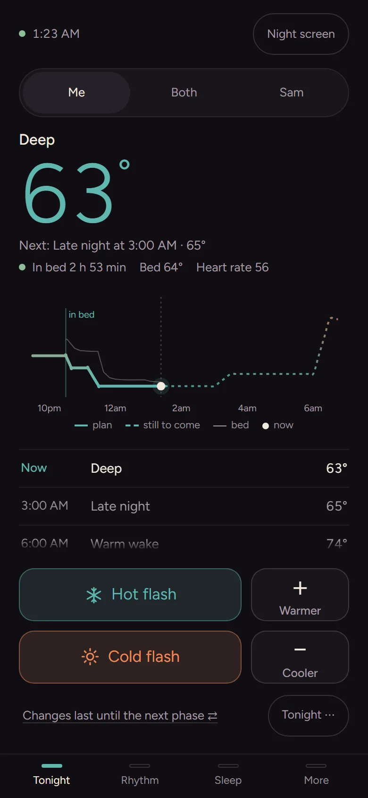
  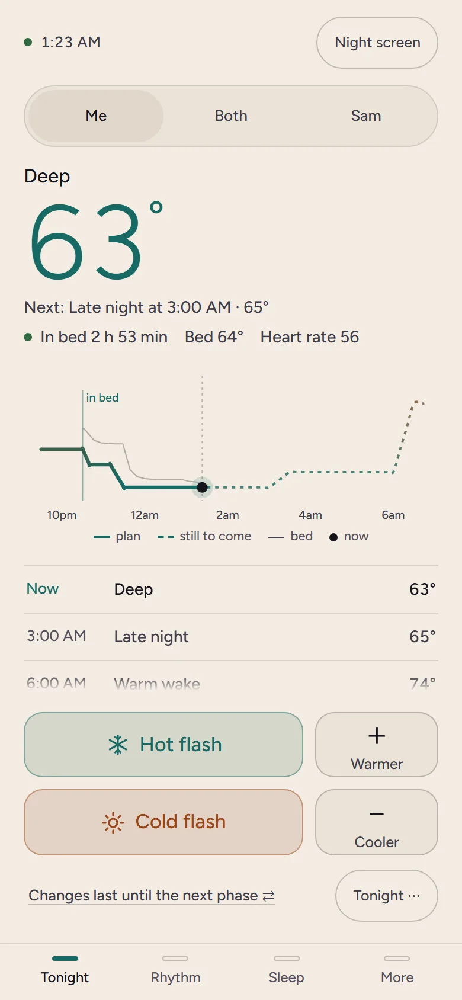
  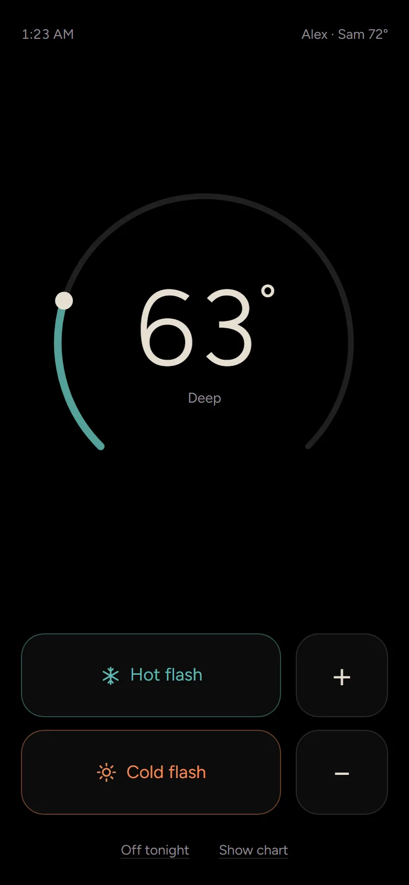
</p>

## Screenshots

| | |
|---|---|
| 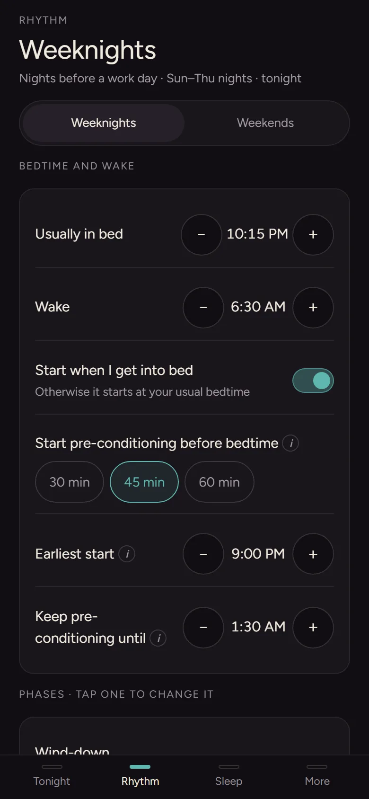 | 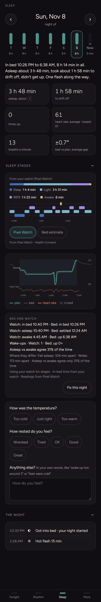 |
| **Rhythm.** Bedtime, wake and phase temperatures for work nights and days off. | **Sleep.** A night in plain words, with stages from a watch and what the bed did. |
| 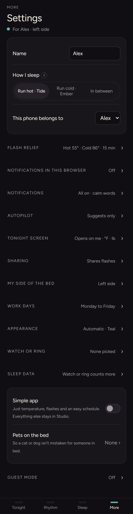 | 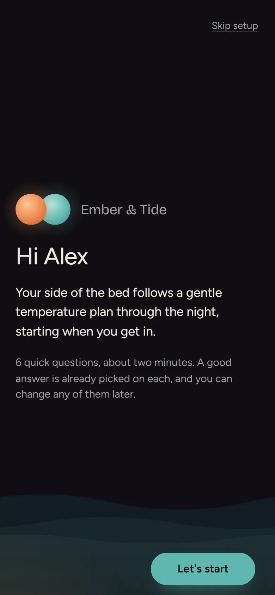 |
| **Settings.** Everything is autosaved, grouped, with a one-line summary each. | **First-run setup.** One decision per screen, a good answer already picked. |

Studio, the power tools on a computer or tablet:

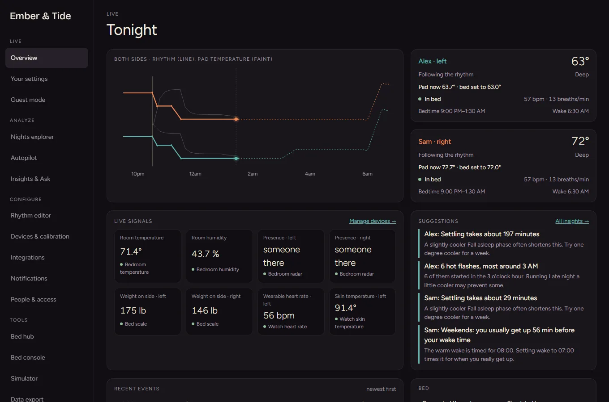

| | |
|---|---|
| 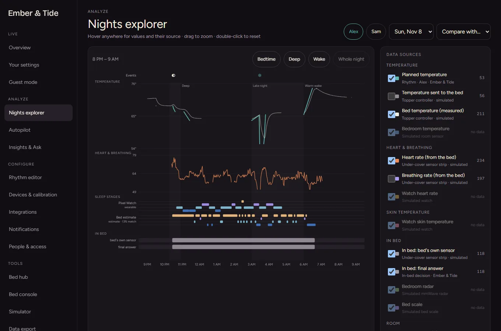 | 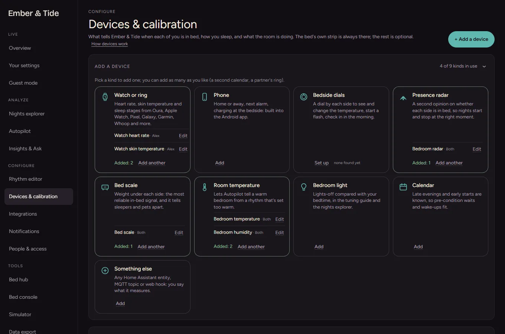 |
| **Nights explorer.** Where every number came from. | **Devices.** Add what you own; everything but the bed is optional. |
| 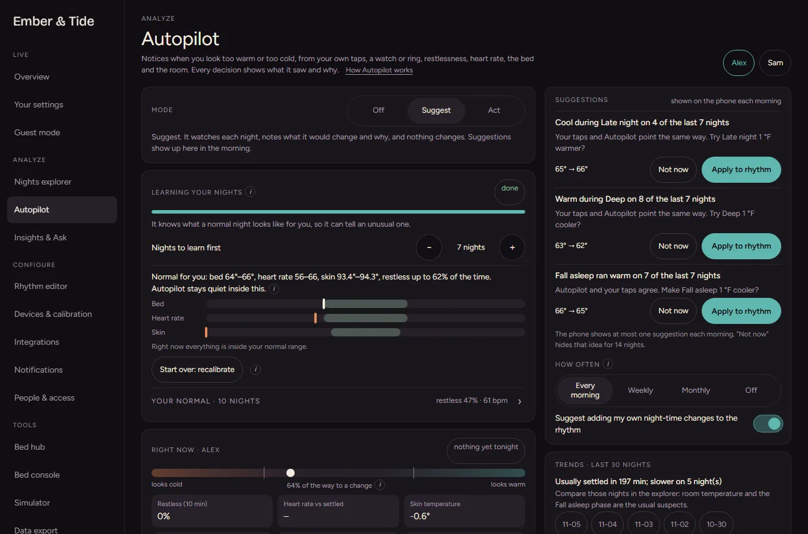 | 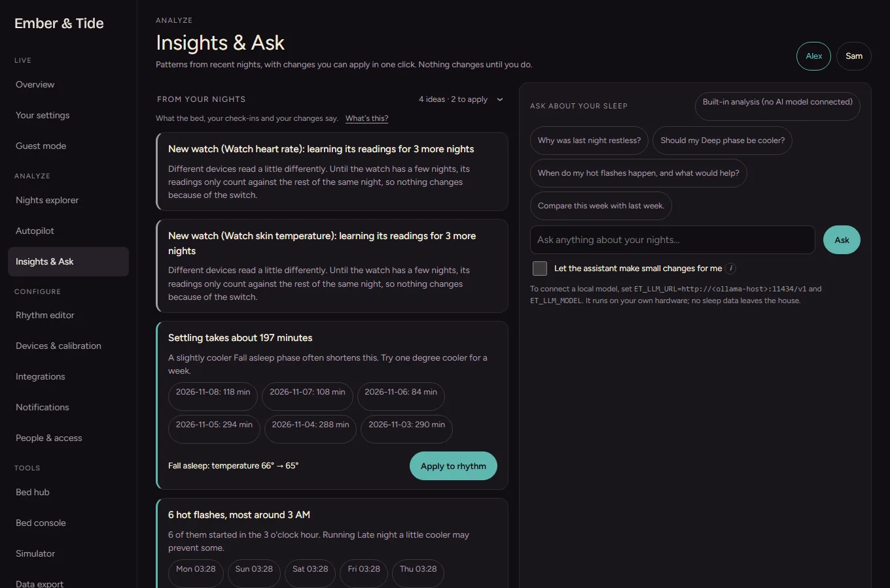 |
| **Autopilot.** Learns your normal, then suggests small explained changes. | **Insights.** Patterns with one-click changes, and an optional assistant. |
| 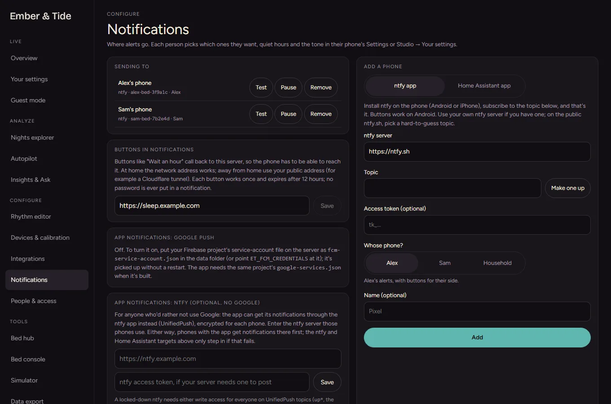 | 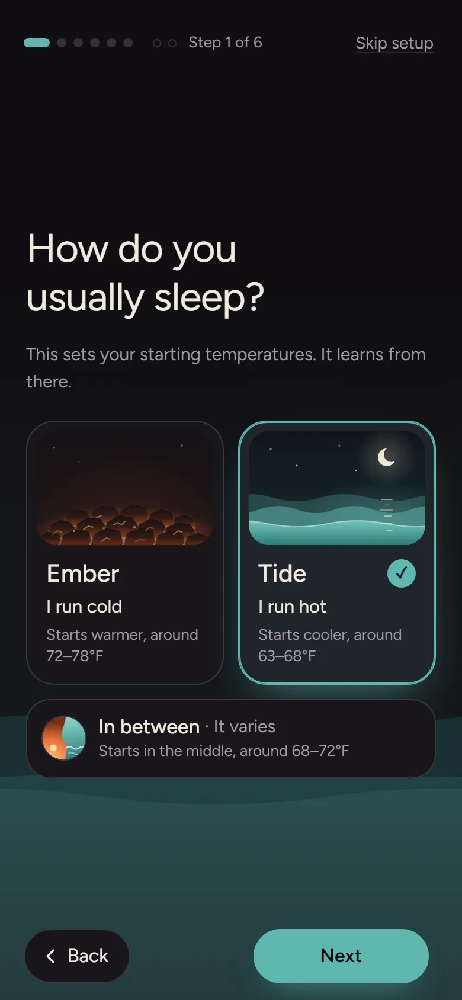 |
| **Notifications.** Google push, ntfy or Home Assistant, each person's choice. | **Setup question.** Ember runs cold, Tide runs hot, or in between. |

## What it does

**Nights and rhythms**
- A rhythm is a plan of phases (wind-down, fall asleep, deep, late night, warm wake) with temperatures, anchored to bedtime, the moment
  you get in bed, a clock time or your wake time. Different rhythms for work nights and days off.
- **The night starts when you are in bed on your side.** Pre-conditioning waits for you; a bedtime window and a schedule fallback cover
  silent sensors. It copes with getting up at night.
- Warmer or cooler for tonight (until the next phase, for the rest of the night, or every night, which edits the rhythm), pause, off tonight,
  start now, and turn on by hand with a timer for naps.

**Flashes and quick controls**
- **Hot flash and cold flash** with sensible defaults (13 °C / 55 °F or 30 °C / 86 °F for 15 minutes, easing back), tunable per person.
- Whole or half-degree steps in °F, chosen per person.
- A **Simple screen for 3 AM**: one temperature, big buttons, deep-red night colours. Optionally a **Simple app** for the less technical
  sleeper: temperature, flashes and an easy schedule, with the detail left in Studio.

**Presence and sensors**
- Presence is a weighted vote of the bed's own sensor strip and anything you add: mmWave radar, bed scales, a phone charging at the
  bedside, a watch, room sensors. It knows about the strip's quirks (one sleeper shown on both pads, half-second false readings, a stalled
  clock) and sets misbehaving devices aside, with an explanation.
- Context, not just sensors: phone at home or on the way home (pre-condition so the bed is ready), evening events and early starts from a
  calendar feed, bedroom lights.
- **Leak sensor safety**: if a connected water leak sensor reports water, both sides switch off and stay off until someone clears it,
  filling and power-on are blocked meanwhile, and the household gets an urgent notification.

**Autopilot and the calibration week**
- A seven-night **calibration week** teaches it what a normal night looks like for each person before it says anything.
- Then it notices patterns (you tap "too warm" in the deep phase, hot flashes cluster at 3 AM, settling takes longer) and either
  **suggests** or, if you choose, **acts** within limits you set. Every decision shows what it saw and why. You decide how much to trust
  the bed, the watch and the room. An optional AI assistant (a model you run, or one you point it at) answers questions and proposes
  changes, never applying them without you.

**Sleep history and wearables**
- A night in plain words, a **Nights explorer** that shows every source, sleep stages (estimated from the bed, or imported from a watch
  or ring), heart rate, skin temperature, and a tuning guide for bedtime and wake drift.
- Wearables arrive from **Health Connect** (Android) or your own cloud account at Oura, Withings, WHOOP or Polar, or generic webhooks and
  JSON pollers. Clock shifts are detected and readings from several devices are lined up.

**Pets, guests and away**
- Pets on the bed are told apart from people (watch mismatch, learned heart-rate signatures) and a pet question lets you teach it.
  **Guest mode** and **away** keep the bed sensible when the household changes. Care reminders for the bed itself (purification tablets, water, a check of the hub and hose), with the maker's guidance as the source.

**Notifications**
- Native app notifications through **Google push (FCM)** or **UnifiedPush/ntfy** with no Google at all, **Web Push** for the iPhone Home
  Screen app and browsers, ntfy topics and Home Assistant targets as fallbacks. Quiet hours, daily caps, a morning summary, one-tap actions
  in the notification, and a tone you pick (calm, friendly, cheeky; alerts are always plain).

**Apps and integrations**
- **Android app** with a resizable home-screen **widget**, a Quick Settings **Hot flash tile**, native notifications, optional phone sources
  and **Health Connect** sync. **Wear OS app, tile and complication** for tonight, temperature and flashes.
- **iPhone**: the web app as a Home Screen app, with notifications (iOS 16.4 or newer). A native app is planned.
- **Home Assistant** over MQTT discovery: a thermostat per side, flash buttons, phase and in-bed sensors, per-phase temperatures. **Voice**
  works through Home Assistant's assistants (Siri, Google Assistant, Alexa, Assist), and through Apple Shortcuts on an iPhone
  ([Talk to your bed](docs/voice.md)).
- **ESPHome bedside dial**: a rotary touch dial per side (shared package in `core/embertide/dial/`), also a Bluetooth beacon that helps
  tell the sleepers apart.
- A simulator with scripted sleepers, a bed console, data export, and API keys for your own scripts. A **demo mode** runs a
  self-contained, resettable copy for showing it to others ([Demo](docs/demo.md)).
- Phones, tablets and foldables: hinge-aware layouts, a navigation rail on big screens, a light theme that keeps text at 4.5:1 contrast.

## How it works

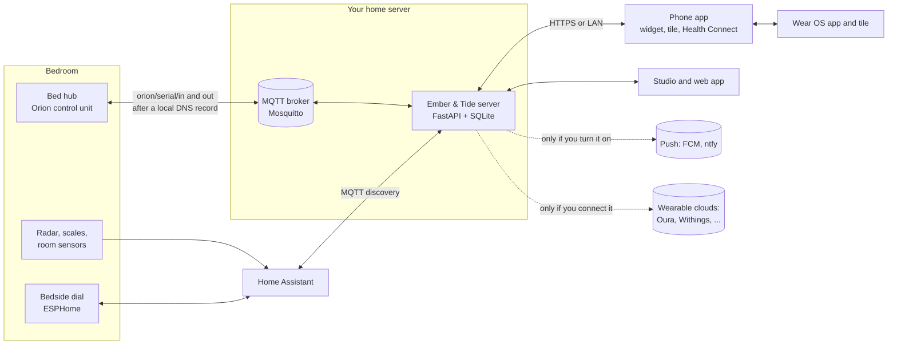

The bed's hub normally connects to the maker's server. A local DNS record makes it connect to your own broker instead, and Ember &
Tide reads its telemetry and sends commands there. One engine in the server owns every write to the bed, with temperature and rate
limits, so every client (the app, a dial, Home Assistant, Autopilot, the assistant) goes through the same checks. Data lives in one
SQLite file.

## Hardware and requirements

- **Required:** an Orion Sleep topper (for the real thing; the simulator needs nothing), and a machine that is always on at home with
  Docker, or Python 3.12. A Raspberry Pi 4, a NAS or a mini PC is plenty.
- **Network:** a router or DNS server where you can add one local DNS record, for local control. Or use the maker's cloud API with a
  personal key instead (slower, needs the internet).
- **Optional:** a mmWave presence radar and a bed scale (the most reliable presence signals), room temperature and humidity sensors,
  Home Assistant, the bedside dial (Elecrow CrowPanel with ESP32-S3, see `core/embertide/dial/`), an Android phone (app, Health Connect),
  a watch or ring (Pixel, Galaxy, Oura, Withings, WHOOP, Polar, Garmin through Health Connect), a Wear OS watch for the app and tile, an iPhone for
  the web app.

## Quick start

Five steps. The [install guide](docs/install.md) has the same steps with what you should see after each one, and sections for Unraid, Synology,
TrueNAS, Proxmox, Raspberry Pi and Linux, Windows and Mac, Portainer, CasaOS and Home Assistant users.

1. **Pick your platform** in [Which way should I install?](docs/install.md#which-way-should-i-install). You need an always-on computer with Docker.
2. **Get the Compose file.** On a NAS (Synology, Unraid) or Windows or Mac, follow the guided steps in [Which way should I install?](docs/install.md#which-way-should-i-install) instead of the terminal commands below. (The project folder holds it and the broker's settings; the app itself comes as a ready-made image.)
   ```bash
   git clone https://github.com/Ncbudd/ember-tide.git
   cd ember-tide
   cp docker-compose.example.yml docker-compose.yml     # set TZ to your time zone
   ```
3. **Start it:** `docker compose up -d` (it pulls `ghcr.io/ncbudd/ember-tide`), then open `http://<server-address>:8790` ([details](docs/install.md#a-the-compose-file-and-the-broker); to build the image yourself, see [Advanced](docs/install.md#advanced-plain-docker-and-running-from-source)).
4. **Set up the app:** create the owner account and follow the short setup ([first-run setup](docs/install.md#b-first-run-setup-in-the-app)). It starts with the
   built-in simulator, so you can look around in **Studio, Simulator** first.
5. **Connect the bed** when you are ready. Easiest: switch two lines in the Compose file to use a personal API key from Orion's web app. Advanced and fully local: add one DNS record
   ([point the bed at your server](docs/install.md#c-point-the-bed-at-your-server), [docs/bed-cutover.md](docs/bed-cutover.md), including how to roll back).

All settings are in [docs/configuration.md](docs/configuration.md).

## Documentation

| Guide | |
|---|---|
| [Install](docs/install.md) | Step by step for Unraid, Synology, TrueNAS, Proxmox, Linux and Raspberry Pi, Windows and Mac, Portainer and CasaOS; first run, HTTPS and iPhone, Home Assistant, fixed addresses, updates and backups |
| [Bed cutover](docs/bed-cutover.md) | The local DNS record, checking the connection, blocking the hub's internet, rolling back, firmware updates |
| [Android](docs/android.md) | Download the APK (Google push or no Google), build it yourself, your own Firebase project, Health Connect, widget and tile, Wear OS |
| [Talk to your bed](docs/voice.md) | Siri, Google Assistant, Alexa and Assist through Home Assistant; Siri with Apple Shortcuts; voice on Android |
| [Connect an AI app](docs/mcp.md) | Ask Claude, Copilot, Cursor or any MCP app about your sleep, and let it propose small changes, through a private key per person |
| [Demo mode](docs/demo.md) | A self-contained demo with a simulated household that resets every hour, safe to share |
| [Configuration](docs/configuration.md) | Every environment variable, the data folder, ports |
| [Troubleshooting](docs/troubleshooting.md) | Hub won't connect, unknown sides, echo, push, Home Assistant, Health Connect |
| [Notifications](docs/notifications.md), [Care](docs/care.md), [Cycle](docs/cycle.md), [Integrations](docs/integrations.md), [Onboarding](docs/onboarding.md), [Settings map](docs/settings-map.md) | How the parts work |
| [Developer handoff](docs/HANDOFF.md) | Architecture, layout, testing, conventions |

## Privacy and security

- **Local first.** The server runs in your home. The bed talks to your broker, the apps talk to your server, and no account with anyone is
  needed. Sleep data lives in one database file in your data folder.
- **Accounts and roles.** The first visit from your home network creates the **owner**; setup over a tunnel or proxy is refused on purpose.
  **Sleepers** control their own side (the partner's only as far as the partner shares it); **viewers** can look. Scripts, Home Assistant and
  dials use API keys; the widget, tile and watch get their own limited device keys that sign-out revokes.
- **Bounded writes.** Everyday range 12 to 35 °C, the bed's hard range 10 to 45 °C, per-side rate limits, an end time stored before any flash
  begins. Firmware, Wi-Fi and low-level pump and valve commands are refused.
- **What leaves the house, only if you turn it on:** push messages through Google (FCM; encrypted for each phone, Google carries ciphertext) or
  through a ntfy server you pick; cloud wearable accounts you connect (Oura, Withings, WHOOP, Polar); an AI model if you point the assistant at one
  (a local model keeps it at home). With none of these, nothing leaves.
- **Run it behind HTTPS** if you reach it away from home, and keep the MQTT broker on your LAN (the bed's side has no password). See [SECURITY.md](SECURITY.md).

## Status and disclaimer

Early (0.x). Verified against the built-in simulator and the Orion local and cloud protocols on firmware 2.6.2. **This is an unofficial community project. It is
not affiliated with, endorsed by or supported by Orion Longevity Inc. or any maker of the hardware it talks to.** Redirecting the bed to your own broker is
outside what the maker supports and may affect your warranty or support. Use it at your own risk, and for comfort only: it is not a medical device.

**Firmware updates are blocked by default**, for two reasons: the commands that could change a bed's firmware are not verified and could leave it unusable, and
firmware changes have altered the data format before. Ember & Tide refuses those commands, and you update on your own terms by pointing the bed back at the maker's
cloud for a while ([how](docs/bed-cutover.md#updating-the-firmware-on-your-terms)). Nothing in this project updates by itself either.

## Contributing

Bug reports, hardware support requests and pull requests are welcome. Read [CONTRIBUTING.md](CONTRIBUTING.md) (setup, tests, style, the plain-language
rule, no personal data) and the [Code of Conduct](CODE_OF_CONDUCT.md). Security issues: [SECURITY.md](SECURITY.md). Changes: [CHANGELOG.md](CHANGELOG.md).

## Credits

Built on community protocol work: tdickman's local MQTT integration, borski's documented cloud API, and firmware notes shared by the community.

## License

[PolyForm Noncommercial 1.0.0](LICENSE). In plain words:

- **Free for personal and household use**, and for noncommercial organisations (charities, schools, public research,
  hobby groups). Use it, change it, share your changes, under the same terms.
- **No commercial use.** A company may not use, sell, bundle, host or ship this code or anything built from it, in
  a product or service, without written permission. That includes bed makers and third-party sellers.
- Shared copies must keep the license and this notice: `Required Notice: Copyright (c) 2026 Ncbudd (https://github.com/Ncbudd/ember-tide)`.

This makes Ember & Tide *source-available*, not "open source" in the OSI sense. For a commercial licence, open an
issue to get in touch.
